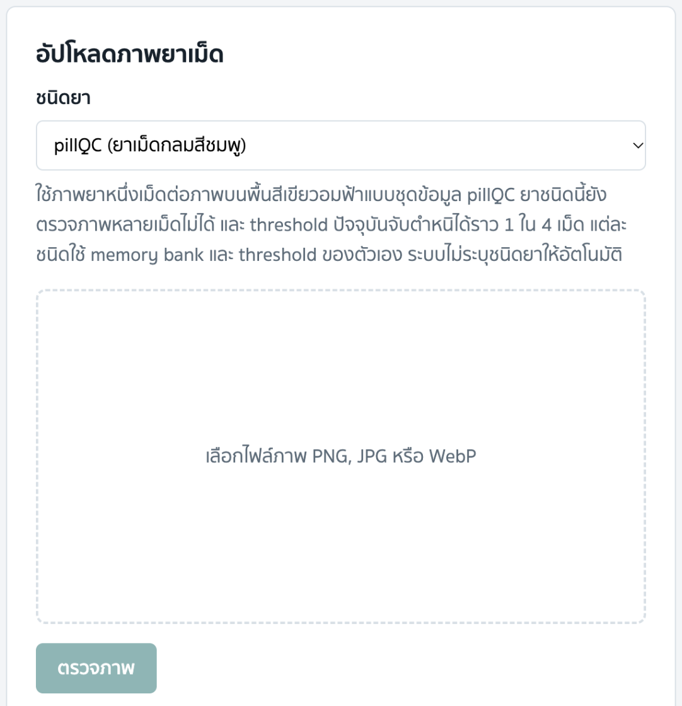
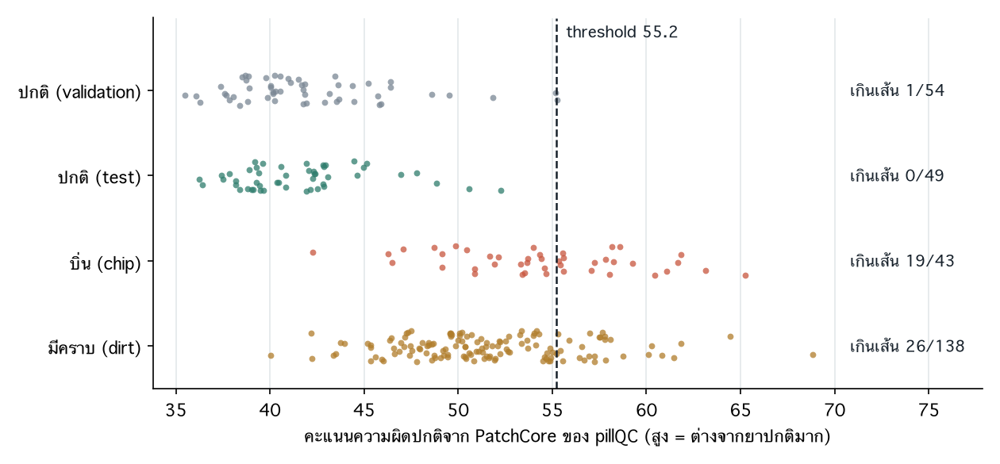
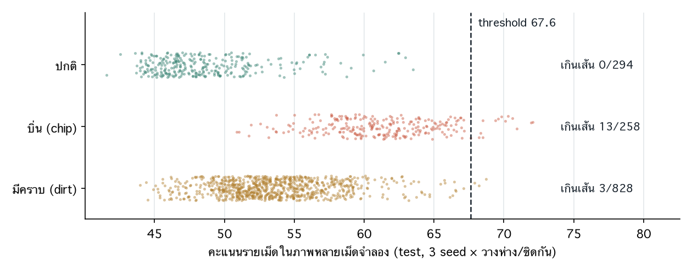

# อัปเดต 11 พ.ย. 2026: เพิ่มตัวเลือกชนิดยาในเว็บ (MVTec Pill และ pillQC)

## สรุป

เว็บต้นแบบตรวจยาได้ 2 ชนิดแล้ว ผู้ใช้เลือกชนิดยาก่อนตรวจ แต่ละชนิดใช้ backbone ตัวเดียวกัน (WideResNet50-2) แต่มี memory bank และ threshold ของตัวเอง ไม่ได้เทรนโมเดลใหม่

| ชนิดยา | ข้อมูลที่ใช้สร้าง memory bank | threshold | ภาพที่รับได้ |
|---|---|---|---|
| MVTec Pill (ยาเม็ดรีสีขาว) | ภาพปกติ 227 ภาพ (เหมือนเดิม) | 36.28 ภาพเดี่ยว / 35.25 หลายเม็ด | ภาพเดียวหรือหลายเม็ดบนพื้นเข้ม |
| pillQC (ยาเม็ดกลมสีชมพู) | ภาพปกติ 46 ภาพ (pool) | 55.21 ภาพเดี่ยว / 67.64 หลายเม็ด | ภาพเดี่ยวบนพื้นสีเขียวอมฟ้า หรือหลายเม็ดบนพื้นเข้ม |

> **อัปเดตส่วนที่ 2 (วันเดียวกัน):** เพิ่มการตรวจภาพหลายเม็ดของ pillQC ระบบแยกเม็ดได้ครบ แต่ threshold ที่ตั้งตามกติกาเดิมจับตำหนิได้เพียง 1.5% ดูหัวข้อ [ภาพหลายเม็ดของ pillQC](#ส่วนที่-2-ภาพหลายเม็ดของ-pillqc)



## เหตุผล

### ทำไมต้องเพิ่ม

ก่อนอัปเดต เว็บมีแค่ memory bank ของยา MVTec PatchCore ตัดสินโดยเทียบแต่ละส่วนของภาพกับยาปกติที่เคยเห็น ยา pillQC เป็นยากลมสีชมพูบนพื้นสีเขียวอมฟ้า ไม่เหมือนยาที่โมเดลรู้จักเลย ทุกเม็ดจึงถูกแจ้งผิดปกติ แม้แต่ยาปกติ (คะแนนต่ำสุดราว 55 เทียบ threshold 35.25)

ภาพทดสอบ pillQC 30 เม็ด (ปกติ 15 มีตำหนิ 15) ถูกแจ้งผิดปกติทั้ง 30 เม็ด


### ทำไมใช้วิธีนี้

- **ตรงกับแนวทางที่เสนออาจารย์:** ใช้ backbone ร่วมกัน และสร้าง memory bank กับ threshold แยกตามชนิดยา เพิ่มชนิดยาใหม่ได้โดยไม่ต้องเทรน backbone
- **ไม่ต้องเทรนเพิ่ม:** PatchCore ไม่ปรับน้ำหนักของ backbone อยู่แล้ว แค่สกัด feature จากภาพปกติมาเก็บ ใช้เวลาสร้างบนเครื่อง Mac ราว 1 นาที (CPU)
- **ใช้กติกา threshold เดิม (ทาง 1):** ตั้ง threshold ที่เปอร์เซ็นไทล์ 99 ของภาพปกติชุด validation ทุกค่าตั้งไว้ก่อน ไม่ได้ปรับจากผล test ผลจึงใช้อ้างในรายงานได้ และตรงกับการทดลองรอบ 2 แถว "ภาพทั้งหมด, seed 42"
- **ไม่เลือกทาง 2:** การเปลี่ยนวิธีตั้ง threshold หลังเห็นว่าผลไม่ดี จะทำให้ผลเป็นแค่ exploratory

### ทำไมส่วนแรกรับแค่ภาพเดียวต่อหนึ่งเม็ด

ระบบแยกเม็ดยาและจัดแนวในเว็บปรับมาสำหรับยา MVTec บนพื้นสีเข้ม และ threshold ของภาพหลายเม็ดตั้งจากยา MVTec เท่านั้น ส่วนแรกจึงตรวจ pillQC แบบเดียวกับการทดลองรอบ 2 คือภาพละหนึ่งเม็ด ภาพหลายเม็ดเพิ่มในส่วนที่ 2 ด้านล่าง

## ผล

### ผลบน test ของ pillQC (โมเดลที่ใช้ในเว็บ)

ทดสอบกับภาพปกติ 49 ภาพ ยาบิ่น 43 ภาพ และยามีคราบ 138 ภาพ

| ค่า | ผล |
|---|---|
| Image AUROC | 0.959 |
| Precision | 1.000 |
| Recall | 0.249 |
| F1 | 0.398 |
| Recall ยาบิ่น | 0.442 (19 จาก 43) |
| Recall ยามีคราบ | 0.188 (26 จาก 138) |
| ยาปกติที่ถูกแจ้งผิด | 0 จาก 49 |

กราฟด้านล่างแสดงคะแนนของทุกภาพ เส้นประคือ threshold ภาพที่อยู่ขวาของเส้นถูกแจ้งผิดปกติ



อ่านกราฟได้ว่า:

- **คะแนนเรียงลำดับได้ดี:** ยาปกติส่วนใหญ่อยู่ซ้าย ยามีตำหนิส่วนใหญ่อยู่ขวากว่า (Image AUROC 0.959)
- **เส้นอยู่สูงเกินไป:** ยามีตำหนิจำนวนมากมีคะแนน 45 ถึง 55 ซึ่งสูงกว่ายาปกติชัดเจน แต่ยังไม่ถึงเส้น จึงถูกตัดสินว่าปกติ
- **สาเหตุ:** ภาพ validation ที่ใช้ตั้งเส้นมาจากภาพถ่ายคนละครั้งกับภาพที่ใช้สร้าง memory bank ภาพปกติบางภาพจึงได้คะแนนสูงถึงราว 55 และกติกาเปอร์เซ็นไทล์ 99 ดันเส้นขึ้นไปตรงนั้น

### ตัวอย่างในเว็บ

ยาปกติผ่าน (คะแนน 42.07 ต่ำกว่า threshold 55.21)


ยามีคราบถูกจับได้ (คะแนน 57.65) heatmap ร้อนทั้งบนคราบบนเม็ดยาและบนเศษดินที่พื้น คะแนนจึงไม่ได้มาจากตำหนิบนเม็ดยาอย่างเดียว


ยาบิ่นหลุด (คะแนน 50.87 ต่ำกว่าเส้น) แม้ heatmap จะชี้ที่รอยบิ่นถูกตำแหน่ง ตัวอย่างนี้แสดงปัญหาเรื่อง threshold ได้ชัดที่สุด


### เทียบกับการทดลองบน Colab

โมเดลในเว็บสร้างใหม่บนเครื่อง Mac (CPU) ด้วยค่าเดียวกับการทดลองรอบ 2 แถว "ภาพทั้งหมด, seed 42" บน Colab (GPU) ผลใกล้กันแต่ไม่เท่ากันพอดี เพราะการเลือก coreset บน CPU กับ GPU ต่างกันเล็กน้อย

| ค่า | Colab (รอบ 2) | เว็บ (Mac) |
|---|---|---|
| Image AUROC | 0.958 | 0.959 |
| Threshold | 54.73 | 55.21 |
| Recall | 0.293 | 0.249 |

คะแนนรายภาพของสองที่สัมพันธ์กัน 0.995 แต่ threshold ต่างกันราว 0.5 ทำให้ recall ต่างกัน 0.04 แสดงว่า recall ของ pillQC ไวต่อตำแหน่งเส้นมาก

## ข้อจำกัด

- ผู้ใช้ต้องเลือกชนิดยาเอง ระบบไม่ระบุชนิดยาอัตโนมัติ ถ้าเลือกผิดชนิด ยาจะถูกแจ้งผิดปกติเกือบทุกเม็ด
- ด้วยกติกา threshold เดิม pillQC จับตำหนิได้ราว 1 ใน 4 เม็ด จึงยังใช้ตัดสินปกติหรือผิดปกติกับยาชนิดใหม่ไม่ได้ การตั้ง threshold สำหรับยาชนิดใหม่ยังเป็นงานต่อไป
- ภาพหลายเม็ดของ pillQC ตรวจได้แล้ว แต่ threshold ตามกติกาเดิมจับตำหนิได้เพียง 1.5% (ดูส่วนที่ 2) และทดสอบบนภาพจำลองที่ตัดแปะเท่านั้น
- ภาพ pillQC เป็นยาราว 28 เม็ดปกติที่ถ่ายซ้ำหลายครั้ง ผลจึงไม่ได้มาจากยาที่เป็นอิสระต่อกันทั้งหมด
- ภาพที่มียา pillQC (ไฟล์ `images/pillqc_*`) ไม่อยู่ใน Git เพราะสัญญาอนุญาตของ pillQC จำกัดการใช้ร่วมกับผลิตภัณฑ์ของ MathWorks

## ส่วนที่ 2: ภาพหลายเม็ดของ pillQC

### ทำไมต้องทำ

ในส่วนแรก ถ้าเลือก pillQC แล้วอัปโหลดภาพหลายเม็ด ระบบย่อทั้งภาพเหลือ 256×256 แล้วให้คะแนนเดียว (เช่น 86.16) ไม่มีผลรายเม็ด และ heatmap แดงทั้งภาพ คะแนนนั้นไม่มีความหมาย

### วิธีที่ทำ

ใช้วิธีเดียวกับที่ทำกับยา MVTec หลายเม็ด เพื่อให้เทียบกันได้

1. **แยกเม็ด:** ใช้ตัวแยกเม็ดตัวเดิม (Otsu + watershed) ได้เลย เพราะยาสีชมพูสว่างกว่าพื้นเข้ม
2. **ตัดเม็ดยาออกมา:** ย่อขยายให้เม็ดยายาวเท่ากับยาในภาพ pillQC (148 จาก 225 พิกเซล) ไม่หมุน เพราะยาเป็นทรงกลม และให้คะแนนเฉพาะบริเวณเม็ดยา
3. **เลือกทาง:** ภาพที่ขอบเป็นสีเขียวอมฟ้า (ภาพ pillQC เดี่ยว) ใช้คะแนนทั้งภาพแบบเดิม ภาพที่พื้นเข้มจะถูกแยกเป็นรายเม็ด
4. **ตั้ง threshold:** ตัดยาปกติชุด validation 54 เม็ดไปแปะบนพื้นเข้ม 8 เม็ดต่อภาพ สุ่ม 5 รอบ ทั้งแบบวางห่างและวางชิด รวม 540 เม็ด แล้วใช้เปอร์เซ็นไทล์ 99 ได้ **67.64** ไม่ได้ใช้ภาพ test ในขั้นนี้
5. **ทดสอบครั้งเดียว:** ยา test 230 เม็ด (ปกติ 49 บิ่น 43 มีคราบ 138) 3 seed × วางห่าง/ชิด รวม 1,380 ครั้ง

### ผล

| ค่า | MVTec หลายเม็ด (เดิม) | pillQC หลายเม็ด |
|---|---|---|
| แยกเม็ดพลาด | 0 | 0 จาก 1,380 |
| AUROC | 0.959 | 0.863 |
| Precision | 0.982 | 1.000 |
| Recall | 0.895 | **0.015** |
| Recall ยาบิ่น | - | 0.050 (13 จาก 258) |
| Recall ยามีคราบ | - | 0.004 (3 จาก 828) |
| ยาปกติที่ถูกแจ้งผิด | - | 0 จาก 294 |

ภาพทดสอบ pillQC 30 เม็ดเดิม ตอนนี้แยกได้ครบ 30 เม็ดพร้อมคะแนนรายเม็ด แต่ทุกเม็ดผ่านว่าปกติ (ถูก 15 จาก 30 เม็ด)




### อ่านผลอย่างไร

- **ระบบทำงานครบ:** แยกเม็ดได้ทุกเม็ด ให้คะแนนรายเม็ด และไม่แจ้งผิดในยาปกติเลย
- **แต่ใช้จับตำหนิไม่ได้:** threshold 67.64 สูงกว่ายาเกือบทุกเม็ด ทั้งยาปกติและยามีตำหนิ
- **ต้นเหตุเดียวกับภาพเดี่ยว แต่หนักกว่า:** ยาปกติชุด validation ได้คะแนนสูงกว่ายาปกติชุด test (สูงสุด 69.8 เทียบกับราว 63.5) เพราะมาจากภาพถ่ายคนละครั้ง การตัดแปะยังเพิ่มความต่างที่ขอบเม็ดยา ทำให้หางของคะแนน validation ยาวขึ้น เปอร์เซ็นไทล์ 99 จึงสูงขึ้นอีก
- **AUROC ลดจาก 0.959 เป็น 0.863:** ส่วนหนึ่งเพราะภาพเดี่ยวมีเศษดินบนพื้นช่วยดันคะแนนของยามีคราบ แต่ในภาพหลายเม็ดเศษดินบนพื้นถูกตัดออก เหลือแค่คราบบนเม็ดยา ผลหลายเม็ดจึงวัดตำหนิบนเม็ดยาได้ตรงกว่า
- **ไม่ได้ปรับ threshold หลังเห็นผลนี้:** ถ้าจะปรับต้องถือเป็นการทดลองเพิ่มเติม (exploratory) ตามกติกาของงาน

### ไฟล์ที่เพิ่มในส่วนที่ 2

| ไฟล์ | สิ่งที่เปลี่ยน |
|---|---|
| `src/evaluate_pillqc_scenes.py` | ตั้ง threshold หลายเม็ดจาก validation (`calibrate`) และทดสอบครั้งเดียว (`test`) |
| `results/pillqc_model/pillqc_scene_results.json` | threshold คะแนนรายเม็ด และผลทดสอบ |
| `backend/segmentation.py` | `align_pill` รับขนาดภาพ ความยาวเม็ด และเลือกไม่หมุนได้ |
| `backend/inference.py` | กำหนดวิธีตัดเม็ดแยกตามชนิดยา (`MVTEC_POSE`, `PILLQC_POSE`) และเลือกทางตามสีขอบภาพสำหรับ pillQC |
| `backend/app.py` | pillQC ใช้ threshold หลายเม็ดของตัวเอง |
| `backend/test_app.py` | test ภาพ pillQC เดี่ยวและภาพหลายเม็ดบนพื้นเข้ม |

ผลของยา MVTec ไม่เปลี่ยน ตรวจแล้วว่าภาพ 24 เม็ดเดิมได้คะแนนเท่าเดิมทุกเม็ด

## ไฟล์ที่เปลี่ยน (ส่วนที่ 1)

| ไฟล์ | สิ่งที่เปลี่ยน |
|---|---|
| `src/build_pillqc_model.py` | สคริปต์ใหม่ สร้าง memory bank และ threshold ของ pillQC |
| `models/patchcore_pillqc_256.pt` | ไฟล์โมเดลใหม่ (ไม่อยู่ใน Git ขนาด 129 MB) |
| `results/pillqc_model/pillqc_model_results.json` | threshold คะแนน validation และผลบน test ของโมเดลในเว็บ |
| `backend/app.py` | รับ `pill_type` (mvtec หรือ pillqc) และโหลดโมเดลตามชนิด ชนิดที่ไม่รู้จักตอบ 400 |
| `backend/inference.py` | ภาพ pillQC เดี่ยวใช้คะแนนจากภาพทั้งภาพ |
| `backend/test_app.py` | test สำหรับการเลือกชนิดยา |
| `frontend/src/App.jsx`, `styles.css` | ตัวเลือกชนิดยาในหน้าอัปโหลด และแสดงชนิดยาในหน้าผล |

สร้างโมเดล pillQC ใหม่ได้ด้วยคำสั่งนี้ (ต้องมีชุดข้อมูลใน `data/pillqc/`)

```bash
backend/.venv/bin/python src/build_pillqc_model.py --root data/pillqc
```

หลังสร้างโมเดลหรือแก้ backend ต้องปิดแล้วเปิด backend ใหม่ เพราะ uvicorn ไม่โหลดใหม่อัตโนมัติ
